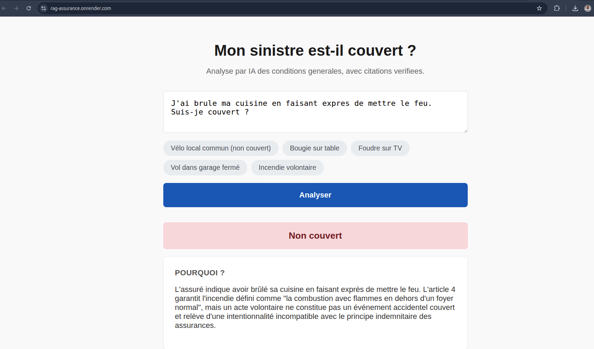
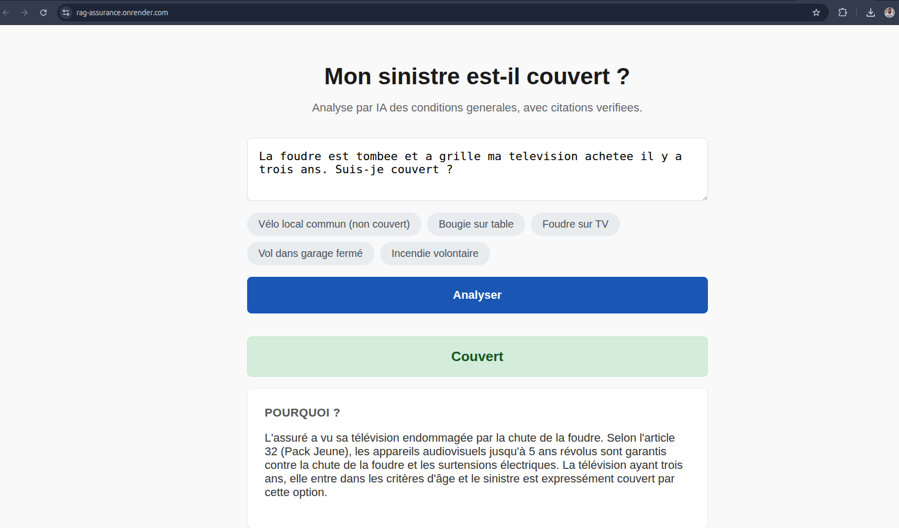

# Mon sinistre est-il couvert ? — RAG sur conditions générales

Démo d'un système qui répond à « mon sinistre est-il couvert ? » à partir de conditions générales d'assurance habitation.

Il ne cherche pas le verdict à tout prix : il **cite les clauses** et répond **« pas de réponse ferme »** quand le contrat ne permet pas de trancher.

## 🔗 Lien démo

**[https://rag-assurance.onrender.com/](https://rag-assurance.onrender.com/)**

## 📸 Aperçu

| Cas non couvert | Cas couvert  |
|:---:|:---:|
|  |  |

## 💡 Exemple concret

> **Situation :** Je me fais voler mon vélo dans le local commun de l'immeuble, qui n'était pas fermé à clé. Suis-je couvert ?
>
> **Verdict :** Pas de réponse ferme (le système détecte que le contrat ne traite pas spécifiquement des vélos dans les parties communes).
>
> **Pourquoi :** L'article 7 exclut explicitement les vols d'objets déposés dans des locaux à usage collectif.
>
> **Ce que le gestionnaire voit :** Le badge de verdict, la clause de l'article 7 surlignée, et la certitude que la citation a été vérifiée mot pour mot par le code. Si le LLM hallucine, le code le détecte et préfère avouer l'incertitude.

## ⚙️ Ce que fait le système

- Lit un contrat (PDF ou texte) et le découpe par article.
- Retrouve les articles proches de la situation (TF-IDF, avec élargissement de la requête).
- Demande au LLM un verdict (couvert, non couvert, ambigu).
- **Vérifie chaque citation par le code** : l'extrait doit exister mot pour mot dans l'article cité.
- Extrait garanties, exclusions, plafonds vers une table SQL pour passer à l'échelle (centaines de contrats).

## 🚀 Lancer en local (Docker)

### Construire l'image

```bash
docker build -t rag-assurance .
```

### Lancer le conteneur

```bash
docker run -p 7860:7860 \
  -e LLM_BASE_URL="https://generativelanguage.googleapis.com/v1beta/openai/" \
  -e LLM_API_KEY="CLE_API" \
  -e LLM_MODEL="gemini-1.5-flash" \
  rag-assurance
```

Ouvrir ensuite :

```text
http://localhost:7860
```

### Optionnel : lancer sans Docker

```bash
pip install -r requirements.txt
uvicorn app.main:app --reload
```

## 🧠 Choix de conception

- **Pas de Streamlit** : Interface HTML/JS sur mesure servie par FastAPI, pour un rendu métier propre et maîtrisé.
- **Garde-fou strict** : Chaque citation est vérifiée mot pour mot. Si le LLM hallucine, le verdict est rétrogradé en « ambigu ».
- **TF-IDF** : Simple, explicable, sans service externe. Limite connue sur les paraphrases, compensée par l'élargissement de requête.
- **FastAPI & Render** : Léger, asynchrone, prêt pour le déploiement. Déployé sur Render (Free Tier).

## 📊 Évaluation

J'ai évalué le système sur un échantillon de 18 questions, tirées au sort parmi un jeu de 50 questions étiquetées à la main sur le contrat Mutuelle de Poitiers. L'évaluation s'est arrêtée car j'ai atteint le quota de l'offre gratuite de l'API Google.

- **Récupération (TF-IDF, hit@6)** : 12/18 (67 %) des questions retrouvent les articles attendus.
- **Verdicts LLM** : 11/18 (61 %) de verdicts corrects.
- **Fiabilité (le plus important)** : **0 % d'erreurs assurées**. Sur les 8 verdicts fermes, aucun n'était faux. Le système préfère dire « ambigu » quand il n'est pas sûr.
- **Détection des cas ambigus** : 3/3 (100 %).
- **Garde-fous déclenchés** : 4 fois sur 18. Le système a détecté que le LLM inventait une citation et a rétrogradé le verdict en « ambigu ».

> **Ce que ça m'a appris :** Le taux d'abstentions inutiles (39 %) montre que le garde-fou (vérification mot pour mot) est très strict. C'est une décision assumée : mieux vaut avouer son incertitude que de donner une réponse fausse. Les échecs de récupération viennent d'un écart de vocabulaire entre la question de l'assuré et le jargon du contrat (ex. « foudre qui a grillé ma télé » vs « dommages d'ordre électrique »). C'est la limite de TF-IDF par rapport aux embeddings, ce qui motive l'élargissement de requête.
